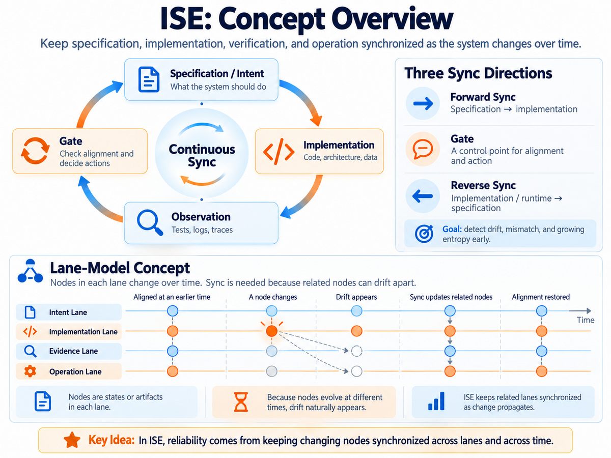

# ISE Methodology

This repository collects the author's thoughts on software development in the AI era, with a focus on **Intent-Synchronized Engineering (ISE)** and the **Lane Model**. As AI has made some familiar ideas and experiences less applicable in practice, it has prompted a closer look at both these new challenges and longstanding cracks in software development. ISE is the author's own attempt to rethink them together and describe what they have led to.

ISE explores how to keep intent aligned with the artifacts and software that express it. The Lane Model describes development as directed flows between states such as intent, specifications, code, and observed facts. Together, they offer a way to think about development work, including how people and AI can take part in it.

The name “Engineering” is a useful label for this work, not a claim that it is a complete or established engineering discipline. ISE draws on ideas from software engineering that the author has studied and found useful, adapts them where they seem applicable, and continues to develop them through personal experience and reflection.

The repository also contains early explorations of **Intent Guidance Engineering (IGE)** and **Orthogonal Dual-Framework (ODF)**. These remain conceptual and are less developed than ISE and the Lane Model.

## Documents

- [ISE overview](ise/README.md)
- [Lane Model: concepts and fundamental structure](lane-model/01_philosophy_and_concepts.md)
- [Overall framework: Environment ⇄ Intent ⇄ Reality](overview.md)
- [ISE background and related essays](philosophies/README.md)
- [IGE overview (early concept)](ige/overview.md)
- [ODF overview (early concept)](odf/overview.md)

## Authorship and AI assistance

The problem identification, key concepts, and final decisions in this repository are by the author (human). On the other hand, AI assistance was received for sentence structure, organization of expressions, and draft generation. Responsibility for the final content lies with the author.

For Japanese, see [README.ja.md](README.ja.md).
