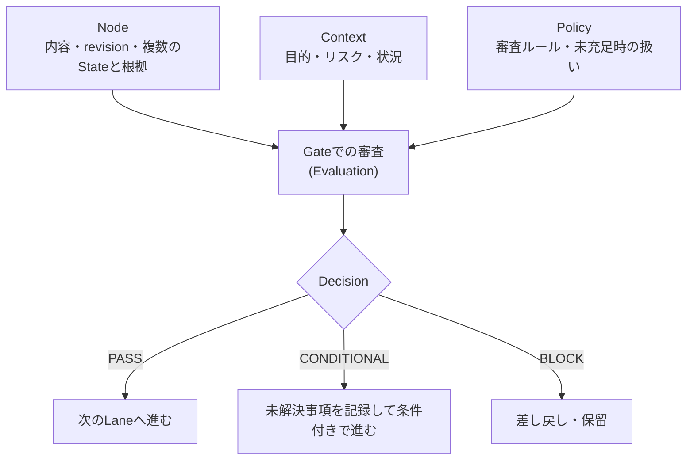
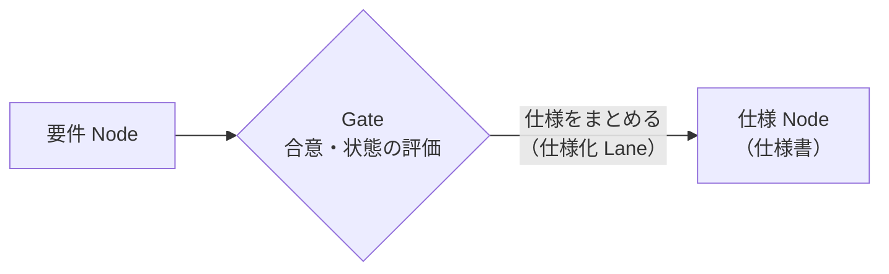
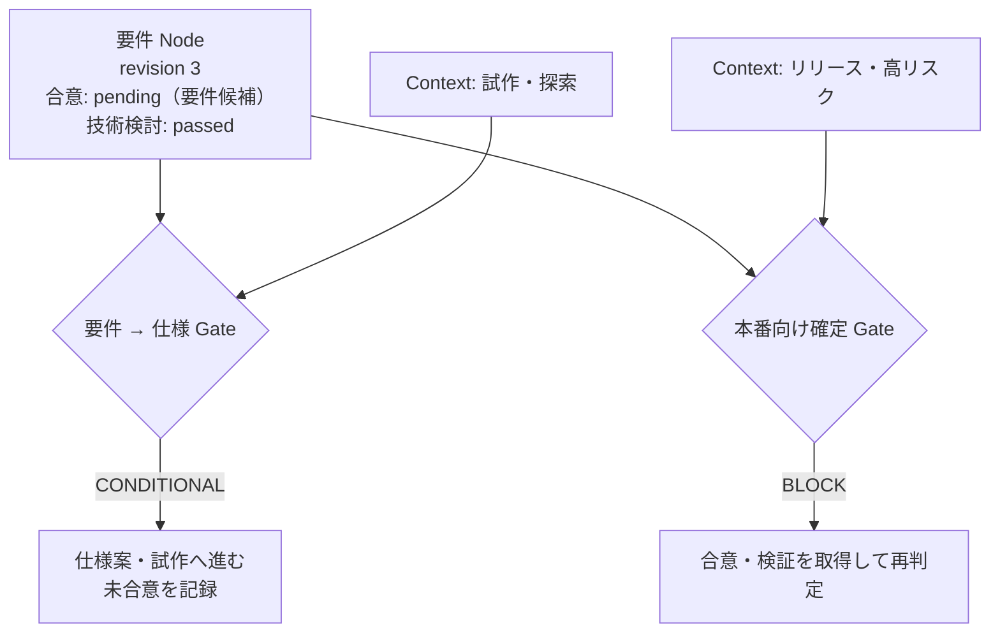
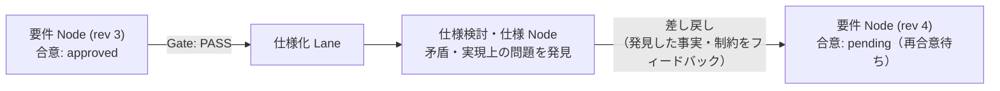

# Gateによる状態評価と要求・要件・仕様への適用

> 本文書は、[Lane Modelの概念と基本構造](01_philosophy_and_concepts.ja.md)および[Laneにおける変換と情報の変化](02_transformation_and_information_change.ja.md)で定義した原則を、実際の開発の流れに当てはめて分かりやすく説明するための文書です。Lane Modelにおける明示的な**Gate**の働きを「国境の審査」になぞらえて整理し、さらに開発現場でよく議論になる「要求・要件・仕様」の違いと差し戻しの流れを具体例として扱います。

---

## 1. 位置づけと目的

[Laneにおける変換と情報の変化](02_transformation_and_information_change.ja.md)で述べたとおり、人が考えを言葉にしたり、要件を仕様やコードへ書き換えたりする過程（Lane）では、情報の選択、省略、解釈が必ず起こります。そのため、開発の同期を保つには「どこまでが合意された事実で、どこからが仮の推測や未決事項なのか」を見分けられるようにしておく必要があります。

ここで、Lane Modelにおける**Gate**には広い意味で「情報の通過時に選択・解釈・判断が発生する場所」という性質があり、次の2つに分けられます。

- **自然発生的なGate**：人が頭の中の考えを言葉や文章にする際や、他者の文章を読み解く際に自然と働く判断です。ここには明文化された規則（Policy）があるわけではありませんが、無意識のうちに情報の取捨選択や解釈が行われます。
- **明示的なGate**：開発プロセスやツール上で、次の作業へ進むための判断基準を明文化した仕組みです。対象Nodeの状態（`State`）、その場の目的や状況（`Context`）、および評価規則（`Policy`）によって進行を判断します。

本文書では、このうち後者の**明示的なGate**がどのように動くかを中心に掘り下げます（第4章で扱う「要求の言語化」では、前者の自然発生的なGateも関わります）。

ここで伝えたい要点は次のとおりです。

- 明示的なGateは「常に通過を禁止・許可する固定の壁」ではなく、**その場の目的や状況（Context）に応じて、次の作業（Lane）へ進んでよいかを判断する仕組み**である。
- Gateが「次に進んでよい」と判断することと、成果物（Node）自体が「完成・合意済みになる」ことは別である。未合意のまま試作に進むような「条件付き進行」も扱える。
- この仕組みを使うと、現場で混乱が起きやすい**「要求」「要件」「仕様」の違い**を、言葉の定義ではなく「誰と誰の情報がどう合流し、どのLaneへ進むか」という図として直感的に説明できる。
- たとえ一度合意して仕様作成へ進んだとしても、合意が内容の正しさを保証するわけではない。仕様を詰める段階で問題が見つかれば、**差し戻し**によって前のLaneへ戻り、要件を直して再合意できる。

---

## 2. 明示的なGateを構成する基本要素

明示的なGateがどのように判断を行うかを整理するため、関係する要素を次のように定義します。

| 要素 | 役割 |
| --- | --- |
| **Node** | 要求、要件、仕様、コードなどの成果物や情報。内容と版（`revision`）に加え、現在の状態（`State`）とその根拠を持つ。 |
| **State** | 「合意済み」「レビュー通過」「テスト成功」「未確認（推定）」など、Nodeが持つ状態。複数持つことができ、いつの版に対する判断かの根拠を伴う。 |
| **Lane** | あるNodeをもとにして、情報を検討・変換し、次のNodeを作ったり更新したりする作業の流れ。 |
| **Gate** | 次のLaneへ進んでよいか、どの条件で進むかを評価・判断する場所。 |
| **Context** | 「試作か本番か」「リスクが高いか低いか」など、いま行おうとしている作業の目的や状況。 |
| **Policy** | Contextに応じて「どのStateが揃っていれば通すか、足りないときにどう扱うか」を定めた規則。 |
| **Decision** | Gateが下した進行判断（通過、条件付き通過、差し戻し・保留）。 |

式として表すと、次のシンプルな関係になります。

```text
GateDecision = evaluate(NodeState, Context, Policy)
```

大切なのは、**Gate自体が成果物の中身の正しさを保証するわけではない**という点です。Gateは「関係者が合意した」「レビューを通った」「CIのテストが成功した」といったNodeのStateと証拠を確認し、いまの目的（Context）に照らして次に進んでよいかを判断します。

### 2.1 Nodeが持つStateと根拠のイメージ

NodeのStateは、単なる「承認済みフラグ（`approved: true`）」ではなく、**誰が・どの版（revision）に・何について・どんな理由で**判断したのかを残せる形として考えます。

```yaml
node:
  id: requirement-001
  revision: 3
  state:
    approvals:
      - actor: requester
        revision: 3
        scope: functional_requirements
        decision: approved
        rationale: "既存業務との互換性を優先する"
        evidence: meeting-record-123
    reviews:
      - actor: developer-review
        revision: 3
        result: passed
        evidence: review-456
```

これは考え方を示すための例であり、特定のフォーマットを強制するものではありません。重要なのは、AIや担当者がコードなどから推測した情報（`inferred`）と、当事者同士が実際に話し合って合意した事実（`approved`）を混ぜずに区別することです。

---

## 3. 国境の比喩で見るGate：厳しさは固定ではない

[Lane Modelの概念と基本構造](01_philosophy_and_concepts.ja.md)では、開発の流れを「道路を走って目的地へ向かうこと」にたとえました。その延長で考えると、明示的な**Gateのイメージに最も近いのは「国境（入国審査・検問所）」**です。厳密な工学上の定義とは異なる部分もありますが、Gateの働きを直感的に掴むには国境を思い浮かべるのが一番分かりやすいでしょう。

現実の国境がどう動いているかを考えると、Lane ModelにおけるGateの4つの特徴がそのまま見えてきます。

1. **国境の場所によって厳しさが違う**
   ほぼ素通りできる国境もあれば、厳重な審査がある国境もあります。開発でも、手元のメモからたたき台を作る境界と、コードを本番環境へリリースする境界では、チェックの厳しさがまったく異なります。
2. **同じ国境でも「目的や状況（Context）」によって条件が変わる**
   同じ国境であっても、数日間の観光や視察で入る場合と、長期の就労や移住で入る場合では、必要な書類も審査の厳しさも変わります。また、平時と緊急時でも基準（Policy）が変わります。
   これと同じで、同じ「要件 → 仕様」や「仕様 → コード」のGateであっても、**試作（prototype）が目的のとき**と**本番出荷（production）が目的のとき**では、未合意の点をどこまで許すかが変わります。
3. **審査官（Gate）が見るのは「証明書と有効期限（State・根拠・revision）」である**
   入国審査官は、提示されたパスポートやビザ、検査証明（Nodeが持つ合意Stateやレビュー・CIの証拠）が本物か、有効期限が切れていないか（古いrevisionに対する合意のまま内容が書き換わっていないか）を確認して、通過（`PASS`）、条件付きの一時通過（`CONDITIONAL`）、通過不可・差し戻し（`BLOCK`）を判断します。
4. **「条件付きで通すこと」と「最終承認されたこと」は別である**
   「まずは短期の視察として入国を認めるが、就労許可を与えたわけではない」のと同じように、Gateが「試作のために仕様作成や実装へ進むこと（`CONDITIONAL`）」を認めても、元の要件Node自体が「最終合意済み（`approved`）」に変わるわけではありません。



### 3.1 Gate Policyのイメージと複数条件の優先原則

同じGateでも目的やリスク（Context）によってルールを切り替えるイメージをYAMLで表すと、次のようになります。

```yaml
gate:
  id: document-to-code
  rules:
    - when: "context.purpose == 'prototype'"
      checks:
        - state: requirements_drafted
          on_failure: warn
    - when: "context.purpose == 'production'"
      checks:
        - state: technical_review_passed
          on_failure: block
        - state: stakeholder_agreement
          on_failure: warn
    - when: "context.risk == 'critical'"
      checks:
        - state: security_review_passed
          on_failure: block
```

この例で「試作（`purpose == 'prototype'`）であり、かつ高リスク（`risk == 'critical'`、たとえば本番データや課金処理に触れる試作）でもある場合」のように、複数の規則が同時にContextへ一致することがあります。

その場合の基本原則として、**「Contextに一致するすべての規則を評価し、最も厳しい判定結果を採用する」**こととします。つまり、一致した規則の中に1つでも条件未達による `block` があれば全体として進行禁止（`BLOCK`）とし、`block` はないが `warn` があれば未解決事項を記録した条件付き進行（`CONDITIONAL`）、すべての条件を満たせば通過（`PASS`）となります。

このように、Gateに最初から「厳しいGate」「緩いGate」という固定のラベルが付いているのではなく、**何を確認し、いまどういうContextで通ろうとしているかの組み合わせによってその場の厳しさが決まります**。

[Laneにおける変換と情報の変化](02_transformation_and_information_change.ja.md)で触れた「明示的なGateの素通り（bypass）」も、ただ検査を無視するのではなく、「試作だから未合意のまま条件付きで通った（`CONDITIONAL`）」として残課題を記録しておけば、後から確認漏れがそのまま本番へ紛れ込むのを防げます。

---

## 4. なぜ「要求」と「要件」は違うのか、どう仕様へ進むのか

このNode・Lane・Gateの考え方を使うと、開発現場でたびたび議論になる「要求」と「要件」の違い、そしてそこから「仕様」へ進む流れをシンプルに説明できます。

なお、要求を出す立場は、受託開発なら「顧客」、自社プロダクト開発なら「PM（プロダクトマネージャー）や事業部門」、社内システムなら「利用部門」など状況によって変わるため、以下ではまとめて**要求側**と呼びます。

### 4.1 「要求」を言葉にする難しさと、「要求・要件」をめぐる議論

ソフトウェア開発では、仕事の進め方や役割分担をめぐって「要求」と「要件」が混同されたり、どこまでをどちらの立場で決めるべきかが議論になったりすることがよくあります。

そもそもの出発点として、「要求」は要求側の頭の中にありますが、**人が自分の頭の中にある要求をそのまま漏れなく文章化（外部化）すること自体が非常に難しい**という問題があります。ここには1章で述べた「自然発生的なGate」が働いており、頭の中の考えを言葉にする段階で必ず省略や偏りが生じます。この点は要求工学（Requirements Engineering）でも古くから指摘されてきました。人は普段当たり前に行っている業務の暗黙の前提を自分から説明するのが難しく、要望同士が矛盾していたり、具体的な形を見るまで自分が本当に必要としているものに気づけなかったりすることが珍しくありません。さらに、それが技術的に実現できるのか、既存システムと矛盾しないか、コストや期間に見合うかといった判断は、開発側の専門知識がなければできません。

こうした議論の中で「そもそも要求と要件は別物である」という説明はよく出てきます。しかし、それを言葉だけで説明しようとすると、「要求は望むことで、要件は合意したことである」といった短い言い換えで終わってしまい、実際に誰と誰がどう関わって要件になり、そこからどう仕様へ進むのかを分かりやすく伝えるのは意外と難しいものです。

### 4.2 挟み撃ちの図で見る「要求 → 要件 → 仕様」の2つの段階

この「言葉だけでは説明しにくい要求と要件の違いと、仕様へ至る流れ」は、Lane Modelを使うと次の**2つの段階**として視覚的に説明できます。

#### 第1段階：要求側と開発側の挟み撃ちで「要件Node」を作り、合意する


第1段階は、左の**要求側**と右の**開発側**が左右から挟み撃ちでコミュニケーションを取り、真ん中の**要件Node**を一緒に組み立てて合意する段階です。

- 左側の要求側からは、困りごとや達成したい目的である「要求」が出ます。ただし頭の中から一度で完全な文章としては出てこないため、対話や確認を繰り返しながら引き出します。
- 右側の開発側からは、技術的な実現可能性、システム上の制約、トレードオフの分析、「こういうやり方なら実現できる」という代替案が出ます。
- この左右からの情報が中央の要件Nodeで合わさり、双方向のすり合わせを経て「この範囲をこの方針で作る」と落ち着いた時点で、要件Nodeに「合意（`approved`）」のStateと理由が記録されます。

なお、要求工学の厳密な用語としては、合意する前の案は「要件候補」、合意した後のものは「合意済み要件」にあたります。本モデルでは、合意の前後でNodeの種類自体を別物に分けるのではなく、**同じ「要件Node」の上でStateが `pending`（要件候補）から `approved`（合意済み要件）へ変化する**ものとして扱います。こうすることで、すり合わせの経緯や、後から修正が入った際の状態変化を1つのNodeの履歴としてそのまま追えるようになります。

この挟み撃ちの図を見れば、なぜ頭の中から出た「要求」がそのまま一方通行で「要件」にならないのか、また、なぜ要求側だけでも開発側だけでも要件を完成させられないのかが一目で分かります。

#### 第2段階：Laneを切り替えて要件から仕様をまとめる



第1段階で要件Nodeの合意が取れたら（あるいは試作のために条件付きで）、明示的なGateを通過してLaneを切り替え、**仕様化Lane**へ進みます。ここでは要件Nodeをもとに、具体的な画面やインターフェース、データの持ち方、細かな振る舞いをまとめて**仕様Node（仕様書）**を作成します。

ただし、この仕様をまとめる段階で矛盾や問題が発生した場合は、前のLane（第1段階の要件Node）へ**差し戻し**て要件を修正し、再合意することができます。なぜなら、ISEおよびLane Modelでは上流から下流への一方通行ではなく、下流で分かった事実や問題を上流へ返す逆方向の経路も認めているからです（詳細は4.4節で述べます）。

### 4.3 未合意のまま試作に進む動きもGateで自然に扱える

実際の開発では、言葉だけで要件をすり合わせても具体的なイメージが湧かないため、「まだ要件として最終合意はしていない（要件候補の段階である）が、たたき台として仕様案や試作を作って動かしてみたい」という場面がよくあります。



もし「合意が済むまでは要件Nodeとして扱えない」と固定してしまうと、「まだ合意していないから試作にも進めない」か、「試作に進むために無理やり合意済みにする」かのどちらかになってしまいます。

これに対しLane Modelでは、要件Nodeの合意Stateは `pending`（要件候補）のまま変えずに、Gateが「いまは試作（`prototype`）というContextだから、未合意という課題を残したまま条件付き進行（`CONDITIONAL`）を認める」と判断します。国境の比喩でいえば「短期の視察として入国を認めるが、永住や就労を承認したわけではない」という扱いです。これにより、実務で当たり前に行われている「まず試作して確かめる」という動きを無理なく表現できます。

### 4.4 合意しても正解とは限らない：仕様段階での問題発見と差し戻し

逆に、第1段階でしっかり話し合って要件Nodeに合意（`approved`）し、Gateを通過して第2段階の仕様作成へ進んだとしても、その要件がそのまま良い結果を生むとは限りません。

要件の段階ではまだ大枠の合意であるため、いざ仕様を細かくまとめたりコードを書いたりする段階になって初めて、「Aという要件とBという要件が細かい条件で矛盾する」「この性能目標は現在の構成では満たせない」といった問題が見つかることは日常茶飯事です。また、試作を動かしてみて初めて、要求側が「本当に欲しかったものはこれではなかった」と気づくこともあります。

こうしたときは、発見した問題を上流へ返して再検討する**差し戻し**によって、第1段階の要件Nodeへ戻ります。



1. 合意済みの要件Node（revision 3）をもとにGateを通過し、仕様化Laneへ進む。
2. 仕様をまとめる中で、要件の矛盾や技術的な問題が見つかる。
3. 見つかった事実や制約を持って第1段階の場へ**差し戻し**、要件Nodeをrevision 4へ修正する。
4. 内容がrevision 4へ変わったため、revision 3に対する過去の合意Stateはそのままでは効力を失い、仕様段階で見つかった理由を添えて再び要求側と開発側で合意を取り直す。

一度合意したことを「絶対に変えてはならない確定事項」ではなく「revision 3の時点で見えていた情報に基づく合意」として扱うため、仕様段階で問題が見つかったら前のLaneへ差し戻し、要件を直して再合意するという現実の開発のサイクルを自然に表せます。

#### 「差し戻し」と「Reverse」の区別

ここで、下流から上流へ情報が戻る動きとして**「差し戻し」**と**「Reverse」**を区別しておきます。

- **差し戻し**：仕様作成や実装を進めている過程、あるいはGateの評価で矛盾や技術的制約を発見し、その明確な理由を上流Nodeへ返して修正・再検討することです。発見された問題や制約自体の根拠ははっきりしています。
- **Reverse**：すでに存在するコードや稼働中のシステムから、書かれていなかった仕様（Pre-Spec）や失われた要件・意図を再構成・復元・更新することです。コードから動作は分かっても「なぜそう作ったのか」という意図までは直接残っていないことが多いため、推定（`inferred`）という不確実なStateを伴います。

どちらも「下流から上流へ向かう経路」を通る点は共通していますが、**情報の確実性**が異なります。仕様段階で問題を見つけて要件へ戻す動きは「差し戻し」であり、既存コードから仕様や要件を掘り起こす「Reverse」とは情報の扱いを分けて管理します。

### 4.5 要求工学との位置づけ

この4章で整理した流れは、既存の要求工学（Requirements Engineering）に反対するものではなく、そこで積み重ねられてきた知見をLane Modelの図と仕組みで分かりやすく説明し直したものです。

- **要求を外部化する難しさと要求獲得・分析・合意形成（Brooks、Christel & Kang、ISO/IEC/IEEE 29148、REBOK）**
  Fred Brooksがソフトウェア開発で最も難しいのは「何を作るかを決めること」だと述べ、Michael ChristelとKyo Kangが要求獲得（Elicitation）における暗黙知やコミュニケーションの課題を整理したように、人の頭の中にある要求を言葉にして引き出す難しさは要求工学の出発点です。また、ISO/IEC/IEEE 29148や要求工学知識体系（REBOK）では、引き出された要求を技術的制約やトレードオフの分析・合意を経てシステム要件（System / Software Requirements）へとまとめます。第1段階の「要求側と開発側の挟み撃ちで要件Nodeを作り合意する」という図は、このプロセスを表しています。
- **問題領域と機械領域の接点（Zave & Jackson）**
  Pamela ZaveとMichael Jacksonは、要求側の業務や環境である「問題領域」と、開発側が作るソフトウェアである「機械領域」の接点に要件と仕様が立つことを示しました。片方の知識だけでは要件が成り立たず、両者が要件Nodeへ合流する構造はこの考え方と一致しています。
- **要件と仕様・設計の往復（Twin Peaksモデル）**
  Bashar NuseibehのTwin Peaksモデルは、要件と設計・仕様が上流から下流へ一方通行で決まるのではなく、仕様や設計を具体化する中で見つかった制約や矛盾を要件へ戻しながら交互に詳細化されることを示しています。第2段階で仕様をまとめる中で問題が見つかり、要件Nodeへ差し戻して再合意する流れは、この往復運動そのものです。

---

## 5. Forward・差し戻し・Reverse・検証への共通適用

このStateとGateの仕組みは、要求から仕様への流れだけでなく、ISEが扱う開発フロー全体に同じように適用できます。

| 局面 | StateとGateの働き |
| --- | --- |
| **Forward（順方向の作業）** | たたき台の作成、関係者との合意、技術レビュー、未決事項の有無をStateとして管理し、次のNode（仕様やコード）の作成へ進むかをGateで判断する。 |
| **差し戻し（上流へのフィードバック）** | 仕様化や実装の途中で見つかった矛盾・技術的制約を根拠として上流Nodeを更新し、新しいrevisionに対して再合意やGateの再評価を行う。 |
| **Reverse（逆方向の抽出・復元）** | 既存のコードや動作から読み取った暫定仕様（Pre-Spec）などを「推定（`inferred`）」のStateとして記録し、そのまま設計判断に使ってよいか、人の確認と合意を求めるかをGateで判断する。 |
| **整合性の確認** | 関連するNode同士の食い違い、条件付き進行で残された未解決事項（`outstanding`）、Nodeの書き換えによって古くなった過去の合意を検査する。 |
| **CI・テスト・リリース判定** | テスト成功やセキュリティ検査通過の記録をCode NodeのStateとして残し、マージや本番リリースのGateで厳格にチェックする。 |

---

## 6. 版（Revision）の更新と再評価

Nodeの中身が書き換わっていく以上、「いつの・どの内容に対して合意やテストが成立したのか」を失わないことが大切です。

- 要件Nodeのrevision 3に対する合意は、内容がrevision 4へ書き換わった後も自動的に有効とは限らない。
- Gateを通過した記録（Decision）には、その時点のNodeのrevision、Context、適用したPolicy、判定結果、根拠（`evidence`）、および残された未解決事項（`outstanding`）を残しておくと後から追跡しやすい。
- 修正範囲がごく一部であれば、すべてを最初から合意し直すのではなく、影響を受ける範囲（`scope`）のStateだけを再確認する進め方もとれる。
- 条件付き進行（`CONDITIONAL`）で先に進んだ場合は、残した課題をいつまでに解消するか（たとえば本番リリースのGateを通る前まで）を見失わないように管理する。

Gate Decisionの記録イメージは次のとおりです。

```yaml
gate_decision:
  gate: requirement-to-specification
  node: requirement-001
  node_revision: 3
  policy_revision: 2
  context:
    purpose: prototype
  result: conditional
  evidence:
    - technical-review-456
  outstanding:
    - requester-approval-pending
```

---

## 7. まとめ

Lane ModelにおけるGateは、広い意味で「情報の通過時に選択・解釈・判断が発生する場所」であり、そのうち開発プロセスやツール上で評価基準を明文化した**明示的なGate**を次のように定義します。

> **明示的なGateは、NodeのStateと遷移時のContextを、適用するPolicyに従って評価し、次のLaneでの利用・変換の可否や条件を判断する機構である。**

この考え方によって、次の点が整理できます。

- 明示的なGateを「国境の審査」になぞらえることで、場所や目的（試作か本番か）によって審査の厳しさが変わること、複数の規則が該当するときは最も厳しい判定が優先されること、また「条件付きで先に進むこと」と「最終合意されたこと」は別であることを直感的に説明できる。
- 要求と要件の違いを、単なる言葉の言い換えではなく、**要求側からの要求と開発側からの分析・提案が左右から挟み撃ちで合流して要件Nodeを作る構造**として視覚的に示せる。また、合意前の「要件候補」と「合意済み要件」を同じ要件NodeのStateの違いとして一貫して扱える。
- 合意した要件からLaneを切り替えて仕様をまとめる際も、合意は正しさを保証しないため、問題が見つかれば**差し戻し**によって前のLaneへ戻り、要件を直して再合意する現実の開発サイクルを自然に表せる。さらに、明確な根拠を持つ「差し戻し」と、既存コードからの推定（`inferred`）を伴う「Reverse」を情報の確実性に応じて区別できる。
- 人による合意、レビュー、AIによる推定、CIの自動テストといった異なる種類の根拠を、NodeのStateとGateの審査という共通の枠組みで扱える。

---

## 参考文献

1. Frederick P. Brooks, Jr., “No Silver Bullet—Essence and Accidents of Software Engineering,” *Computer*, 20(4), 10–19, 1987. [DOI](https://doi.org/10.1109/MC.1987.1663532)
2. Michael G. Christel and Kyo C. Kang, *Issues in Requirements Elicitation*, Technical Report CMU/SEI-92-TR-012, Software Engineering Institute, Carnegie Mellon University, 1992.
3. ISO/IEC/IEEE 29148, *Systems and software engineering — Life cycle processes — Requirements engineering*.
4. 情報サービス産業協会（JISA）REBOK企画委員会編, 『要求工学知識体系 第1版（REBOK: Requirements Engineering Body of Knowledge）』, 近代科学社, 2011.
5. Pamela Zave and Michael Jackson, “Four Dark Corners of Requirements Engineering,” *ACM Transactions on Software Engineering and Methodology (TOSEM)*, 6(1), 1–30, 1997. [DOI](https://doi.org/10.1145/237432.237434)
6. Michael Jackson, *Problem Frames: Analysing and Structuring Software Development Problems*, Addison-Wesley, 2001.
7. Bashar Nuseibeh, “Weaving Together Requirements and Architectures,” *Computer*, 34(3), 115–117, 2001. [DOI](https://doi.org/10.1109/2.910904)
