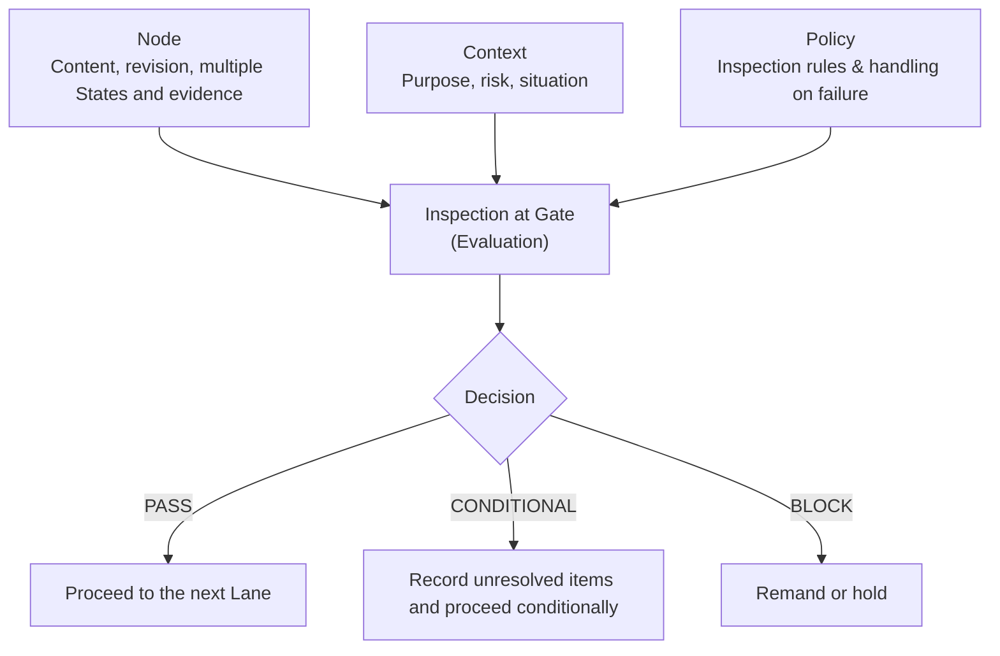
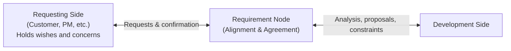
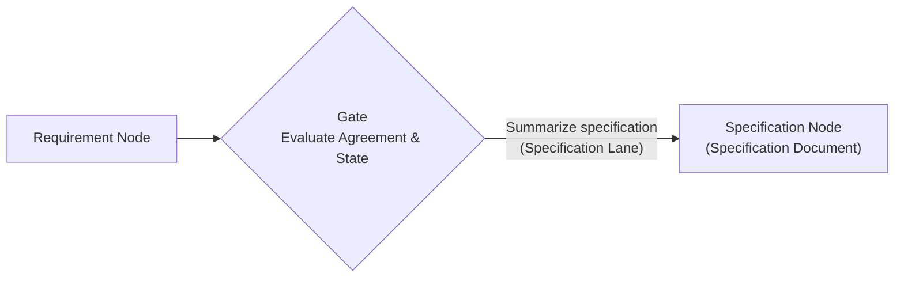
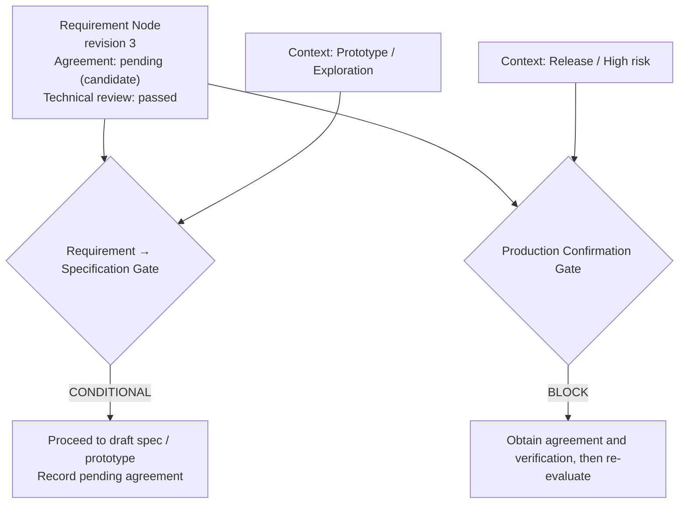
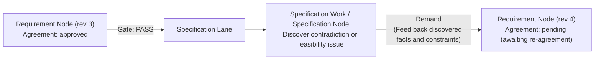

# State Evaluation at Gates and Application to Requests, Requirements, and Specifications

> This document applies the principles defined in [Lane Model: Concepts and Fundamental Structure](01_philosophy_and_concepts.md) and [Transformation and Information Change in Lanes](02_transformation_and_information_change.md) to practical development flows in an accessible way. It explains the role of an explicit **Gate** in the Lane Model using the metaphor of a border checkpoint, and uses the distinction and remand flow among "requests, requirements, and specifications" as a concrete example.

---

## 1. Positioning and Purpose

As described in [Transformation and Information Change in Lanes](02_transformation_and_information_change.md), whenever people put thoughts into words or turn requirements into specifications and code (traversing a Lane), information is inevitably selected, omitted, and interpreted. Keeping development synchronized therefore requires making it possible to distinguish between what has been agreed upon as fact and what remains a tentative inference or an open question.

In the Lane Model, a **Gate** in the broad sense refers to any point where selection, interpretation, or judgment occurs as information passes through, and can be divided into two kinds:

- **Naturally Occurring Gates**: Judgments that operate naturally when people put internal thoughts into words or text, or when they read and interpret someone else's text. Although no written rule (`Policy`) exists here, unconscious selection and interpretation of information inevitably take place.
- **Explicit Gates**: Mechanisms in development processes or tools that codify the criteria for advancing to the next activity. They evaluate progression based on the target Node's `State`, the immediate purpose and situation (`Context`), and evaluation rules (`Policy`).

This document focuses primarily on how the latter—**Explicit Gates**—operate (while the former, naturally occurring Gates, also come into play during the verbalization of wishes discussed in Section 4).

The main points are as follows:

- An explicit Gate is not a fixed wall that uniformly blocks or allows passage; **it is a mechanism that judges whether work may proceed to the next Lane according to the immediate purpose and situation (Context)**.
- A Gate judging that "work may proceed" is separate from the artifact (Node) itself being "complete or agreed upon." Conditional progression—such as moving ahead with a prototype before final agreement—can also be handled.
- Using this mechanism makes it possible to explain the often-confused distinction among **"requests," "requirements," and "specifications"** visually—in terms of whose information converges where and which Lane comes next—rather than relying solely on verbal definitions.
- Even after reaching agreement and moving on to writing specifications, agreement does not guarantee that the content is correct. If issues surface while detailing the specification, **remand** allows work to return to the previous Lane so the requirement can be revised and re-agreed.

---

## 2. Basic Elements of an Explicit Gate

To organize how an explicit Gate makes decisions, the participating elements are defined as follows:

| Element | Role |
| --- | --- |
| **Node** | Artifacts or information such as requests, requirements, specifications, or code. In addition to content and a `revision`, it holds current `State` entries and their supporting evidence. |
| **State** | Statuses held by a Node, such as "approved," "review passed," "tests succeeded," or "unverified (`inferred`)." A Node can hold multiple States, each tied to a specific revision and evidence. |
| **Lane** | A flow of work that takes a Node as input, examines or transforms its information, and creates or updates the next Node. |
| **Gate** | A point that evaluates and decides whether and under what conditions work may proceed to the next Lane. |
| **Context** | The purpose and situation of the work being attempted, such as "prototyping vs. production" or "high risk vs. low risk." |
| **Policy** | Rules defining which States are required for a given Context and how unmet conditions are handled. |
| **Decision** | The progression judgment made by the Gate (pass, conditional pass, or block/remand). |

Expressed as a formula, this is a simple relationship:

```text
GateDecision = evaluate(NodeState, Context, Policy)
```

Crucially, **a Gate does not by itself guarantee the correctness of an artifact's content**. Rather, a Gate inspects the Node's States and evidence—such as "stakeholders agreed," "review passed," or "CI tests succeeded"—and judges whether work may proceed in light of the current purpose (Context).

### 2.1 How a Node Holds States and Evidence

Rather than a simple boolean flag (`approved: true`), a Node's State is structured to retain **who made the judgment, on which revision, regarding what scope, and for what reason**:

```yaml
node:
  id: requirement-001
  revision: 3
  state:
    approvals:
      - actor: requester
        revision: 3
        scope: functional_requirements
        decision: approved
        rationale: "Prioritize compatibility with existing operations"
        evidence: meeting-record-123
    reviews:
      - actor: developer-review
        revision: 3
        result: passed
        evidence: review-456
```

This is an illustrative example and does not mandate a specific format. What matters is keeping information inferred from code by an AI or analyst (`inferred`) distinct from facts actually discussed and agreed upon by the parties involved (`approved`).

---

## 3. Gates Through the Border Metaphor: Strictness Is Not Fixed

In [Lane Model: Concepts and Fundamental Structure](01_philosophy_and_concepts.md), development flows were compared to driving along roads toward a destination. Extending that metaphor, **the closest everyday image of an explicit Gate is a border checkpoint (immigration and customs)**. While not identical to a formal engineering definition in every detail, thinking of a border checkpoint is the easiest way to grasp how a Gate behaves.

Considering how real borders operate reveals four key characteristics of Gates in the Lane Model:

1. **Strictness varies depending on which border you cross**
   Some borders can be crossed with almost no friction, while others require strict inspection. In development as well, the boundary between jotting down notes and drafting an initial sketch differs completely in strictness from the boundary of releasing code to production.
2. **Even at the same border, requirements change depending on the purpose and situation (Context)**
   At the very same border, entering for a few days of sightseeing or a short site visit requires different documents and faces different scrutiny than entering for long-term employment or permanent residency. Inspection criteria (Policy) also change between normal times and emergencies.
   In the same way, even at the same "Requirement → Specification" or "Specification → Code" Gate, **how much unagreed content is tolerated differs when the purpose is prototyping (`prototype`) versus production release (`production`)**.
3. **What the inspector (Gate) checks is "certificates and expiration dates (State, evidence, and revision)"**
   An immigration officer checks whether the presented passport, visa, or inspection certificate (the Node's agreement State and review or CI evidence) is genuine and has not expired (that the content has not been rewritten since an earlier revision's approval), and then decides among passage (`PASS`), conditional temporary entry (`CONDITIONAL`), or denial/remand (`BLOCK`).
4. **Allowing conditional entry is not the same as granting final approval**
   Just as allowing someone to enter on a short-term visit does not mean granting them a work permit or permanent residency, when a Gate permits conditional progression (`CONDITIONAL`) to specification or prototyping, the underlying Requirement Node itself does not become finally approved (`approved`).



### 3.1 Example of a Gate Policy and Precedence When Multiple Rules Match

Switching rules at the same Gate according to purpose and risk (Context) can be represented in YAML as follows:

```yaml
gate:
  id: document-to-code
  rules:
    - when: "context.purpose == 'prototype'"
      checks:
        - state: requirements_drafted
          on_failure: warn
    - when: "context.purpose == 'production'"
      checks:
        - state: technical_review_passed
          on_failure: block
        - state: stakeholder_agreement
          on_failure: warn
    - when: "context.risk == 'critical'"
      checks:
        - state: security_review_passed
          on_failure: block
```

In this example, multiple rules can match the Context simultaneously—for instance, when work is a prototype (`purpose == 'prototype'`) that also carries high risk (`risk == 'critical'`, such as a prototype touching production data or billing systems).

As a foundational principle in such cases, **all rules matching the Context are evaluated, and the strictest resulting outcome takes precedence**. That is, if any matching rule fails a check configured with `block`, progression is blocked overall (`BLOCK`); if there are no `block` failures but one or more `warn` failures, conditional progression with unresolved items recorded (`CONDITIONAL`) is returned; and if all matching checks pass, passage (`PASS`) is granted.

Thus, a Gate does not carry a permanent "strict" or "loose" label from the outset; **its strictness at any moment is determined by the combination of what it checks and the Context for which passage is sought**.

The "bypass" of an explicit Gate mentioned in [Transformation and Information Change in Lanes](02_transformation_and_information_change.md) can also be handled not by blindly ignoring inspection, but by recording open issues as a `CONDITIONAL` passage for prototyping so that unverified items do not slip into production unnoticed later.

---

## 4. Why Requests and Requirements Differ, and How Work Proceeds to Specifications

Using this framework of Nodes, Lanes, and Gates makes it possible to explain the recurring debates around "requests" and "requirements"—and how work moves from there to "specifications"—in a simple, concrete way.

Because the party originating requests varies by situation—a customer in contract development, a product manager (PM) or business unit in in-house product development, or an operational department in internal systems—this document refers to them collectively as the **Requesting Side**.

### 4.1 The Difficulty of Putting Wishes into Words, and Debates Over Requests vs. Requirements

In software development, "requests" and "requirements" are often conflated when discussing how work should proceed and how responsibilities should be divided, leading to frequent debates over how much each side should define.

The starting point is the requesting side's wishes, concerns, and goals. Some have not yet been put into words; others have already been expressed. In this model, the information the requesting side communicates about those wishes to the Requirement Node is called a **request**. This is a convention used by the model, not the only definition used in Requirements Engineering.

**Putting unspoken wishes into words without omissions is difficult**, and a communicated request may not fully capture the original wish. The "naturally occurring Gate" described in Section 1 is at work here: externalization involves omissions and bias. People may struggle to explain assumptions they take for granted, hold conflicting wishes, or discover what they need only after seeing something concrete. Assessing technical feasibility, compatibility with existing systems, cost, and schedule also requires the development side's expertise.

In these discussions, it is often noted that "requests and requirements are two different things." Yet when explained in words alone, the explanation tends to stop at brief rephrasings such as *"a request is what is wanted, and a requirement is what is agreed upon,"* making it surprisingly difficult to convey clearly how both sides actually interact to form a requirement and how work then advances to specifications.

### 4.2 Two Stages of "Requests → Requirements → Specifications" Seen Through the Convergence Diagram

This distinction between requests and requirements—and the subsequent flow to specifications—can be explained visually in the Lane Model as **two stages**.

#### Stage 1: Forming and Agreeing on the "Requirement Node" from Both Sides



Stage 1 is the stage in which the **Requesting Side** on the left and the **Development Side** on the right communicate from both sides to build and agree upon the central **Requirement Node** together:

- The requesting side communicates its wishes and concerns as "requests." Because a request may not fully express the underlying wish, repeated dialogue and confirmation deepen understanding and allow it to be revised.
- From the development side on the right come technical feasibility judgments, system constraints, trade-off analyses, and alternative proposals (*"It can be realized if approached this way"*).
- Information from left and right meets at the central Requirement Node, and once two-way alignment settles on *"we will build this scope under this approach,"* an `approved` State and its rationale are recorded on the Requirement Node.

In this model, a draft before agreement is called a "candidate requirement" and one after agreement an "agreed requirement." Rather than splitting these into two different Node types, the model treats them as **the same "Requirement Node" whose State transitions from `pending` (candidate requirement) to `approved` (agreed requirement)**. This allows the history of alignment and subsequent revisions to be tracked on a single Node.

The diagram shows how both sides contribute their knowledge to form a requirement, rather than a communicated request becoming a requirement through a one-way handoff.

#### Stage 2: Switching Lanes to Summarize Specifications from Requirements



Once agreement is reached on the Requirement Node in Stage 1 (or conditionally for prototyping), work passes through the explicit Gate, switches Lanes, and enters the **Specification Lane**. Based on the Requirement Node, this Lane summarizes concrete screens, interfaces, data structures, and detailed behaviors to create a **Specification Node (specification document)**.

However, if contradictions or problems arise while summarizing the specification at this stage, work can be **remanded** to the previous Lane (the Requirement Node in Stage 1) to revise the requirement and re-agree. This is possible because ISE and the Lane Model are not one-way top-down pipelines; they also recognize reverse paths that feed facts and problems discovered downstream back upstream, as described in Section 4.4.

### 4.3 Proceeding to Prototyping Before Final Agreement Is Handled Naturally at the Gate

In real-world development, verbal alignment alone is often not enough to form a concrete picture, leading to situations where *"we haven't reached final agreement on the requirements yet (they are still candidate requirements), but we want to draft a specification or build a prototype to see it in action."*



If "a Node cannot be treated as a Requirement Node until agreement is complete" were enforced as a rigid rule, teams would be forced into either *"we cannot even prototype because it isn't agreed yet,"* or *"we have to pretend it is already agreed just to move forward."*

In the Lane Model, the Requirement Node's agreement State remains `pending` (candidate requirement), while the Gate judges that *"because the current Context is prototyping (`prototype`), conditional progression (`CONDITIONAL`) is permitted while keeping pending agreement on record."* In terms of the border metaphor, this is like permitting entry for a short-term site visit without granting permanent residency or a work permit. This allows the everyday engineering practice of "prototyping first to verify" to be represented naturally.

### 4.4 Agreement Does Not Guarantee Correctness: Discovering Issues During Specification and Remanding

Conversely, even when both sides thoroughly discuss and agree (`approved`) on a Requirement Node in Stage 1 and pass the Gate into Stage 2 specification work, that requirement is not guaranteed to produce a good result as-is.

Because requirements represent high-level agreement, it is commonplace when summarizing detailed specifications or writing code to discover that *"Requirement A and Requirement B conflict under specific conditions,"* or *"this performance target cannot be met with the current architecture."* Likewise, seeing a working prototype often makes the requesting side realize, *"What we actually wanted was something else."*

In such cases, work returns to the Requirement Node in Stage 1 via **remand**, returning the discovered problem upstream for re-examination.



1. Based on the agreed Requirement Node (revision 3), work passes the Gate and enters the Specification Lane.
2. While summarizing the specification, a contradiction in the requirements or a technical issue is discovered.
3. Carrying the discovered facts and constraints, work is **remanded** to Stage 1, revising the Requirement Node to revision 4.
4. Because the content has changed to revision 4, the prior approval State on revision 3 no longer automatically applies, and the requesting and development sides re-align and re-agree with the reasons found during the specification stage.

Because prior agreement is treated not as "an immutable final decision," but as "agreement based on the information visible at revision 3," the real-world development cycle—remanding to the previous Lane when problems surface during specification, revising the requirement, and re-agreeing—can be represented naturally.

#### Distinguishing Between "Remand" and "Reverse"

Here, two kinds of upstream information flow are distinguished: **Remand** and **Reverse**.

- **Remand**: Discovering a contradiction or technical constraint while creating specifications or implementations (or during Gate evaluation), and returning that explicit reason upstream to revise and re-examine the upstream Node. The evidence for the discovered problem or constraint itself is clear.
- **Reverse**: Reconstructing, recovering, or updating unwritten specifications (Pre-Specs) or lost requirements and intent from already existing code or running systems. Because code shows observable behavior but often does not directly preserve the original rationale (*"why it was built that way"*), Reverse carries an uncertain `inferred` State.

While both traverse a path from downstream to upstream, **the certainty of their information differs**. Returning to requirements after finding a problem during specification work is a "remand," and is managed separately from "Reverse," which excavates specifications and requirements from existing code.

### 4.5 Relationship to Requirements Engineering

The flow organized in Section 4 does not oppose established Requirements Engineering; rather, it re-explains the knowledge accumulated in that field in an accessible way using the diagrams and mechanisms of the Lane Model:

- **Difficulty of externalizing wishes, and elicitation, analysis, and negotiation (Brooks, Christel & Kang, ISO/IEC/IEEE 29148, REBOK, IPA)**
  Fred Brooks described deciding what to build as a central difficulty of software development, while Michael Christel and Kyo Kang examined tacit knowledge and communication challenges in requirements elicitation. Drawing out and expressing people's wishes is an important challenge in Requirements Engineering. ISO/IEC/IEEE 29148, the Requirements Engineering Body of Knowledge (REBOK), and IPA's *Requirements Management Handbook for the AI Era* also address analyzing elicited information and developing system and software requirements. The Stage 1 diagram represents these activities in the model's own terms.
- **Intersection of the problem world and the machine (Zave & Jackson)**
  Pamela Zave and Michael Jackson showed that requirements and specifications stand at the intersection between the "problem world" (the requesting side's operations and environment) and the "machine" (the software built by the development side). Neither side's knowledge alone suffices; the structure in which both converge on the Requirement Node aligns with this insight.
- **Back-and-forth between requirements and specification/design (Twin Peaks model)**
  Bashar Nuseibeh's Twin Peaks model shows that requirements and architectural/specification design are not decided in a one-way top-down pass; instead, constraints and contradictions found while detailing designs and specifications feed back to refine requirements iteratively. Discovering an issue while summarizing specifications in Stage 2 and remanding to the Requirement Node to re-agree is this exact back-and-forth movement.

---

## 5. Common Application Across Forward, Remand, Reverse, and Verification

This mechanism of States and Gates applies in the same way across all development flows handled by ISE, not just the flow from requests to specifications.

| Aspect | Role of States and Gates |
| --- | --- |
| **Forward (forward work)** | Manage drafting, stakeholder agreement, technical review, and open questions as States, and use Gates to decide whether to proceed to creating the next Node (specifications or code). |
| **Remand (upstream feedback)** | Update upstream Nodes based on contradictions or technical constraints discovered during specification or implementation, and perform re-agreement and Gate re-evaluation on the new revision. |
| **Reverse (reverse extraction and reconstruction)** | Record provisional specifications (Pre-Specs) read from existing code or behavior with an `inferred` State, and use Gates to decide whether they may be used directly for design decisions or require human confirmation and agreement. |
| **Consistency checks** | Inspect mismatches among related Nodes, unresolved items (`outstanding`) left by conditional progression, and prior agreements that have become outdated due to Node edits. |
| **CI, testing, and release judgment** | Record passing tests and security checks as States on Code Nodes and inspect them strictly at merge or production release Gates. |

---

## 6. Updating Revisions and Re-evaluation

Because the contents of Nodes are rewritten over time, it is important not to lose track of **when and for what content an agreement or test passed**:

- Agreement on revision 3 of a Requirement Node does not automatically remain valid after the content is rewritten to revision 4.
- Keeping the Node revision at the time of passage, the Context, the applied Policy, the decision result, the `evidence`, and any `outstanding` items in the Gate Decision record makes later tracking straightforward.
- When a revision only affects a small part of a Node, rather than re-approving everything from scratch, teams can re-verify only the State for the affected `scope`.
- When advancing via conditional progression (`CONDITIONAL`), teams manage when the remaining issues must be resolved (for example, before passing the production release Gate) so they are not forgotten.

An example of a recorded Gate Decision:

```yaml
gate_decision:
  gate: requirement-to-specification
  node: requirement-001
  node_revision: 3
  policy_revision: 2
  context:
    purpose: prototype
  result: conditional
  evidence:
    - technical-review-456
  outstanding:
    - requester-approval-pending
```

---

## 7. Summary

In the Lane Model, a Gate in the broad sense is any point where selection, interpretation, or judgment occurs as information passes through; among these, an **Explicit Gate** whose evaluation criteria are codified in development processes or tools is defined as follows:

> **An explicit Gate is a mechanism that evaluates a Node's State and the transition Context according to an applicable Policy to determine whether and under what conditions the Node may be used or transformed in the next Lane.**

This perspective clarifies the following points:

- Comparing an explicit Gate to **border inspection** makes it intuitive why strictness changes depending on location and purpose (prototyping vs. production), why the strictest outcome takes precedence when multiple rules match, and why "proceeding conditionally" is distinct from "reaching final agreement."
- The difference between requests and requirements can be shown visually—not merely as a rephrasing of words, but as **a structure in which requests from the requesting side and analysis and proposals from the development side converge from left and right to form a Requirement Node**. Moreover, "candidate requirements" before agreement and "agreed requirements" after agreement can be handled consistently as different States of the same Requirement Node.
- Even when switching Lanes from an agreed requirement to summarize specifications, agreement does not guarantee correctness; if problems surface, **remand** naturally represents the real-world development cycle of returning to the previous Lane, revising the requirement, and re-agreeing. Furthermore, "remand" based on clear evidence can be distinguished from "Reverse" involving inference (`inferred`) from existing code according to the certainty of the information.
- Diverse kinds of evidence—human agreement, peer review, AI inference, and automated CI tests—can be handled within a single common framework of Node States and Gate inspections.

---

## References

1. Frederick P. Brooks, Jr., “No Silver Bullet—Essence and Accidents of Software Engineering,” *Computer*, 20(4), 10–19, 1987. [DOI](https://doi.org/10.1109/MC.1987.1663532)
2. Michael G. Christel and Kyo C. Kang, *Issues in Requirements Elicitation*, Technical Report CMU/SEI-92-TR-012, Software Engineering Institute, Carnegie Mellon University, 1992.
3. ISO/IEC/IEEE 29148, *Systems and software engineering — Life cycle processes — Requirements engineering*.
4. Requirements Engineering Body of Knowledge (REBOK) Planning Committee, Japan Information Technology Services Industry Association (JISA), *Requirements Engineering Body of Knowledge (REBOK)*, Kindai Kagaku Sha, 2011.
5. Pamela Zave and Michael Jackson, “Four Dark Corners of Requirements Engineering,” *ACM Transactions on Software Engineering and Methodology (TOSEM)*, 6(1), 1–30, 1997. [DOI](https://doi.org/10.1145/237432.237434)
6. Michael Jackson, *Problem Frames: Analysing and Structuring Software Development Problems*, Addison-Wesley, 2001.
7. Bashar Nuseibeh, “Weaving Together Requirements and Architectures,” *Computer*, 34(3), 115–117, 2001. [DOI](https://doi.org/10.1109/2.910904)
8. Information-technology Promotion Agency, Japan (IPA), *Requirements Management Handbook for the AI Era* (『AI時代の要求管理ハンドブック』), [URL](https://www.ipa.go.jp/digital/kaihatsu/youkyu-kanri.html)
